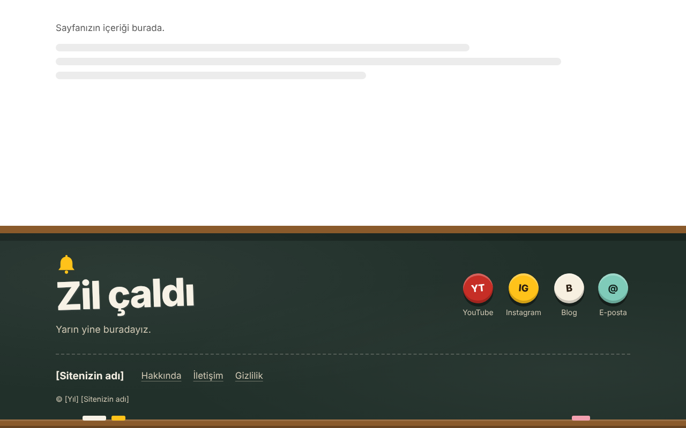
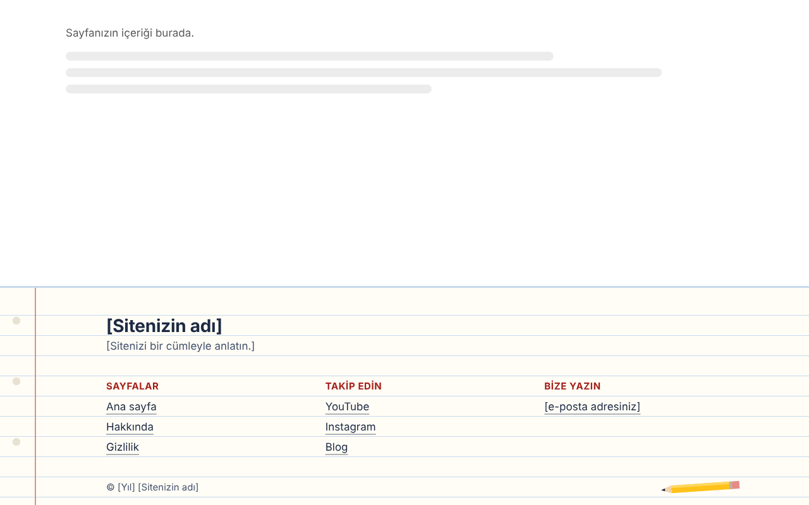
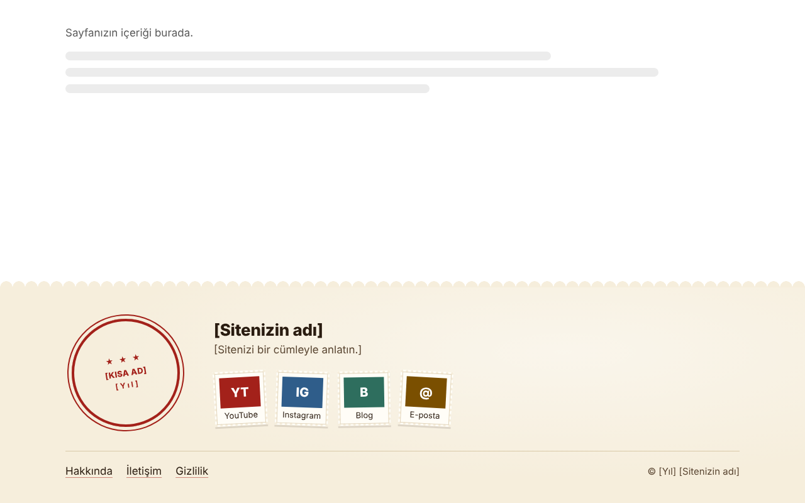
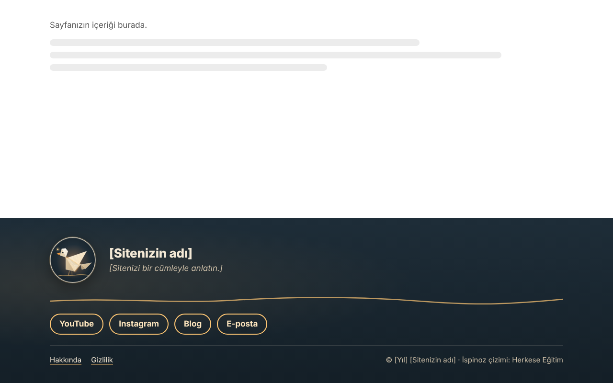

# Herkese Eğitim footer kit v1

[Türkçe](README.md) · [herkeseegitim.com](https://herkeseegitim.com/?ref=github) · [YouTube @egitimtek](https://www.youtube.com/@egitimtek)

Four classroom-themed footers for your site, blog or class page. Free. Each one is a single HTML snippet you copy and paste. No internet connection needed, no outside fonts or images, no JavaScript.

Open `index.html` in a browser to see all four side by side.

## How to use

1. **Copy.** Right-click `footer.en.html` in the theme folder and choose "Open with" > Notepad (TextEdit on a Mac). Select all with Ctrl+A and copy with Ctrl+C. If you double-click the file, the browser shows the footer itself, not the code. The same code is in `footer.en.txt`, which opens as plain text in the browser; the "Kodu (EN)" link in `index.html` opens it too.
2. **Paste.** Paste the code at the very bottom of your page (see "For your site" below). If your page already has a footer, remove it: keep one footer per page. The style block at the top of the code and the footer go together; do not split them.
3. **Replace the placeholders.** Replace everything in square brackets (`[Your site name]`, `[Year]`, `[your email address]`, the links) with your own details, brackets included. In the paper and stamp theme, put a `[Short name]` in the stamp: two short words at most (e.g. Maths Corner). You can delete the `<li>…</li>` line of any link you do not use.

## For your site

**Google Sites:** Insert > Embed > Embed code. Paste the code and drag the box to the bottom of the page. Google Sites shows the code in a separate frame; make the box taller until the whole footer shows.

**Blogger:** Layout in the left menu > "Add a Gadget" at the bottom of the page > HTML/JavaScript. Paste the code and save.

**WordPress (block theme):** Appearance > Editor > Patterns or Template parts > Footer. Delete the existing footer, add a "Custom HTML" block and paste the code. A "Custom HTML" block inside a post puts the footer inside the post, not at the bottom of the page.

**WordPress.com free and paid:** On the free plan the style block may be removed, and the footer then shows without colours. The "Additional CSS" field is on paid plans: you can move the contents of the style block there. Self-hosted WordPress (wordpress.org) does not have this limit.

**Plain HTML page:** Paste the code just above the `</body>` line.

## Themes

| Folder | Theme | What it has |
|---|---|---|
| `tebesir-tahtasi` | Chalkboard | Green board, wooden frame, chalk tray, "The bell rang". Social links sit like magnets on the board. |
| `defter-cizgisi` | Notebook lines | A lined notebook page: red margin, punched holes, text on the lines, three link columns. |
| `kagit-muhur` | Paper and stamp | Cream paper with a scalloped edge. Your short name in a stamp, social links as postage stamps. |
| `ispinoz` | Finch | Night-blue background, a paper finch drawing, a thin branch. Links as buttons. |

Each folder has `footer.html` (Turkish), `footer.en.html` (English), plain-text copies of the same code `footer.txt` and `footer.en.txt`, `onizleme.html` (preview on an empty page), `onizleme.png` (1280 px) and `onizleme-390.png` (phone). The previews show the Turkish version.

### Chalkboard

[On a phone](tebesir-tahtasi/onizleme-390.png)

### Notebook lines

[On a phone](defter-cizgisi/onizleme-390.png)

### Paper and stamp

[On a phone](kagit-muhur/onizleme-390.png)

### Finch

[On a phone](ispinoz/onizleme-390.png)

## Turkish and English

Each theme has two separate files: `footer.html` in Turkish and `footer.en.html` in English. Separate files mean you copy one language only, the `lang` attribute is right, and the two never mix.

## Accessibility and fit

- Text contrast is at least 4.5:1 (measured).
- Every link is at least 44 px tall and 44 px wide; the focus outline is visible when using the keyboard.
- With "reduce motion" on, animations stop.
- No sideways overflow at 320 px. The footer changes layout by its own width, so it also works inside a narrow column.
- Each theme has its own background, so it reads on light and dark sites alike.
- Class names carry a theme prefix. The footer sets its own colors, fonts and spacing. Your site's general link or menu rules may still change small details; check the page after pasting.
- If the footer does not reach both edges of the page, that comes from your site's page margin; it does not break the look.
- The footer carries `role="contentinfo"`, so keep one per page.
- Fonts are the device's own. No outside requests.

## License

MIT, for code and text. See `LICENSE`. Copyright: Herkese Eğitim.

Exception: the finch drawing in the finch theme is not covered by MIT; it belongs to Herkese Eğitim. You may use it as it is inside this footer; do not distribute it as a separate image, and keep the "Finch drawing: Herkese Eğitim" line in the footer. The same exception is written at the end of `LICENSE` and in the first line of the finch files.
