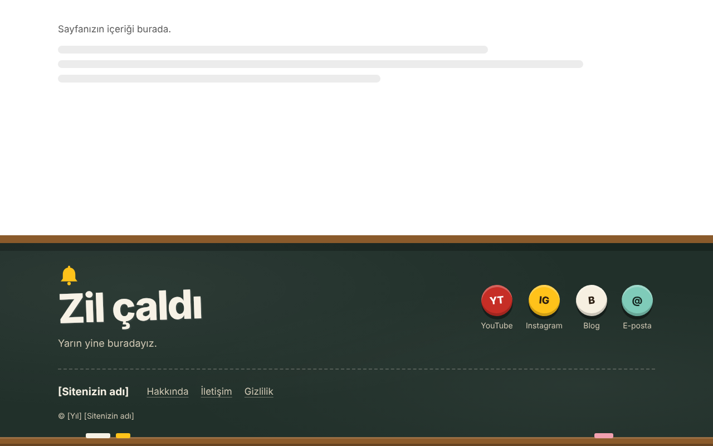
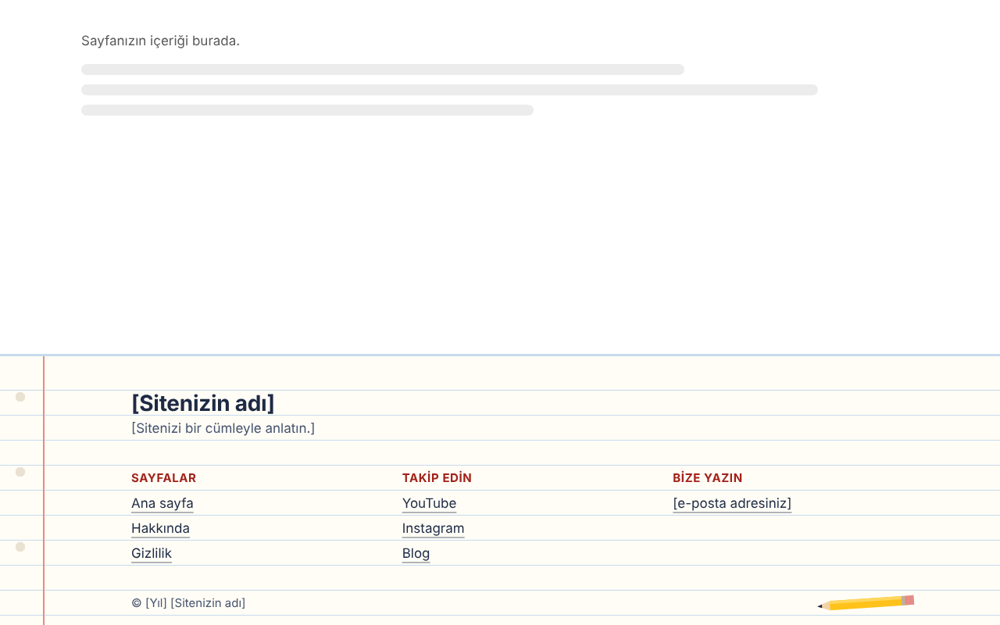
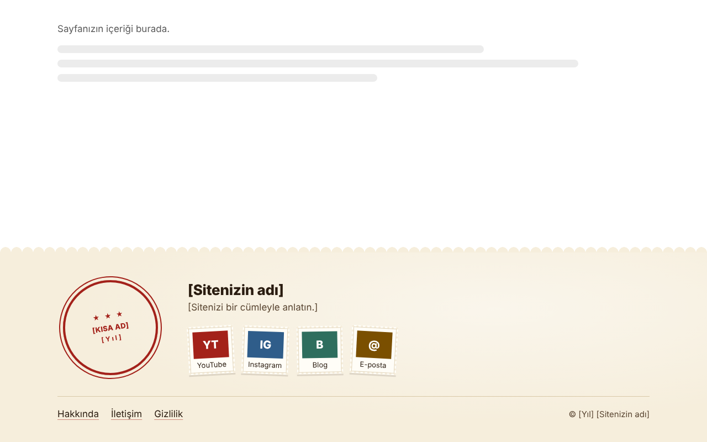
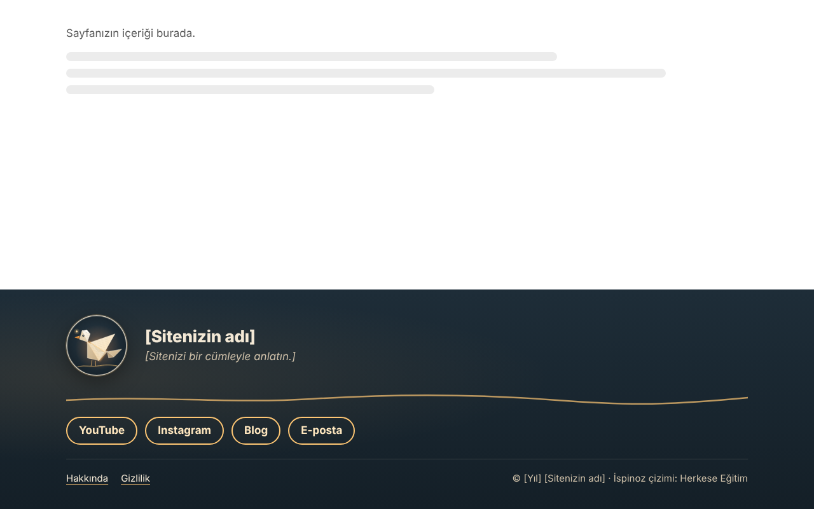

# Herkese Eğitim footer kiti v1

[English](README.en.md) · [herkeseegitim.com](https://herkeseegitim.com/?ref=github) · [YouTube @egitimtek](https://www.youtube.com/@egitimtek)

Sitenizin, blogunuzun ya da sınıf sayfanızın en altına koyabileceğiniz dört alt bilgi (footer). Ücretsiz. Her biri tek parça HTML: kopyalayıp yapıştırırsınız. İnternet bağlantısı istemez, dışarıdan yazı tipi ya da resim çekmez, JavaScript yok.

Dördünü yan yana görmek için `index.html` dosyasını tarayıcıda açın.

## Nasıl kullanılır

1. **Kopyalayın.** Temanın klasöründeki `footer.html` dosyasına sağ tıklayın, "Birlikte aç" > Not Defteri (Mac'te TextEdit) seçin. Ctrl+A ile hepsini seçip Ctrl+C ile kopyalayın. Dosyaya çift tıklarsanız tarayıcıda footer'ın görüntüsü açılır, kodu değil. Aynı kod `footer.txt` dosyasında da var; o tarayıcıda düz metin olarak açılır. `index.html` içindeki "Kodu (TR)" bağlantısı da onu açar.
2. **Yapıştırın.** Kodu sayfanızın en altına yapıştırın (aşağıda "Sitenize göre"). Sitenizde başka bir alt bilgi varsa onu kaldırın: sayfada tek footer olsun. Kodun başındaki stil bloğu ile footer birlikte gider; ikisini ayırmayın.
3. **Yer tutucuları değiştirin.** Köşeli parantez içindeki her şeyi (`[Sitenizin adı]`, `[Yıl]`, `[e-posta adresiniz]`, bağlantı adresleri) kendi bilgilerinizle değiştirin, parantezleri de silin. Kâğıt ve mühür temasında mühüre `[Kısa ad]` yazın: en çok iki kısa sözcük (örnek: Matematik Köşesi). Kullanmadığınız bir bağlantının `<li>…</li>` satırını silebilirsiniz.

## Sitenize göre

**Google Sites:** Ekle > Göm > Kodu göm. Kodu yapıştırın, kutuyu sayfanın en altına sürükleyin. Google Sites kodu ayrı bir çerçevede gösterir; kutunun yüksekliğini footer tam görünene kadar büyütün.

**Blogger:** Sol menüde Düzen > sayfanın en altındaki "Gadget ekle" > HTML/JavaScript. Kodu yapıştırıp kaydedin.

**WordPress (blok tema):** Görünüm > Düzenleyici > Desenler ya da Şablon parçaları > Alt bilgi. Var olan alt bilgiyi silin, yerine "Özel HTML" bloğu ekleyip kodu yapıştırın. Yazının içindeki "Özel HTML" bloğu footer'ı yazının içine koyar, sayfanın en altına değil.

**WordPress.com ücretsiz ve ücretli:** Ücretsiz planda stil bloğu silinebilir; o zaman footer renksiz görünür. "Ek CSS" alanı ücretli planlarda var: stil bloğunun içindekileri oraya taşıyabilirsiniz. Kendi sunucunuzdaki WordPress'te (wordpress.org) bu sınır yok.

**Düz HTML sayfası:** Kodu `</body>` satırının hemen üstüne yapıştırın.

## Temalar

| Klasör | Tema | Ne var |
|---|---|---|
| `tebesir-tahtasi` | Tebeşir tahtası | Yeşil tahta, ahşap çerçeve, tebeşir rafı, "Zil çaldı". Sosyal bağlantılar tahtaya yapışmış mıknatıslar gibi. |
| `defter-cizgisi` | Defter çizgisi | Çizgili defter sayfası: kırmızı kenar çizgisi, delikler, satıra oturan yazı, üç sütun bağlantı. |
| `kagit-muhur` | Kâğıt ve mühür | Krem kâğıt, tırtıklı kenar. Kısa adınız mühürde, sosyal bağlantılar pul gibi. |
| `ispinoz` | İspinoz | Gece mavisi zemin, kâğıt ispinoz çizimi, ince bir dal. Bağlantılar düğme biçiminde. |

Her klasörde: `footer.html` (Türkçe), `footer.en.html` (İngilizce), aynı kodun düz metin kopyaları `footer.txt` ve `footer.en.txt`, `onizleme.html` (boş bir sayfada nasıl durduğu), `onizleme.png` (1280 px) ve `onizleme-390.png` (telefon).

### Tebeşir tahtası

[Telefonda](tebesir-tahtasi/onizleme-390.png)

### Defter çizgisi

[Telefonda](defter-cizgisi/onizleme-390.png)

### Kâğıt ve mühür

[Telefonda](kagit-muhur/onizleme-390.png)

### İspinoz

[Telefonda](ispinoz/onizleme-390.png)

## Türkçe ve İngilizce

Her temada iki ayrı dosya var: `footer.html` Türkçe, `footer.en.html` İngilizce. Ayrı dosya seçtik çünkü kopyalarken tek dil gelir, `lang` özniteliği doğru olur, iki dil birbirine karışmaz.

## Erişilebilirlik ve uyum

- Yazı ile zemin arasındaki kontrast en az 4,5:1 (ölçüldü).
- Her bağlantı en az 44 px yüksekliğinde ve 44 px genişliğinde; klavyeyle gezerken odak çerçevesi görünür.
- "Hareketi azalt" ayarı açıksa animasyonlar durur.
- 320 px genişlikte yana taşma yok. Footer kendi genişliğine göre düzen değiştirir; dar bir sütuna konsa da çalışır.
- Her temanın kendi zemini var: siteniz açık ya da koyu temada olsa da okunur.
- Sınıf adları temaya özel önekli (`hek-tahta-`, `hek-defter-`, `hek-muhur-`, `hek-ispinoz-`). Footer kendi rengini, yazı tipini ve boşluklarını ayarlar. Sitenizin genel bağlantı ya da menü kuralları yine de küçük ayrıntıları değiştirebilir; yapıştırdıktan sonra sayfaya bir bakın.
- Footer sayfanın iki kenarına değmiyorsa sitenizin sayfa kenar boşluğundandır; görünüşü bozmaz.
- Footer `role="contentinfo"` taşır. Bu yüzden sayfada bir tane olmalı.
- Yazı tipi, cihazın kendi yazı tipidir. Dış istek yok.

## Lisans

MIT. Kod ve metin için geçerlidir. Ayrıntı: `LICENSE`. Telif: Herkese Eğitim.

İstisna: ispinoz temasındaki ispinoz çizimi MIT kapsamında değildir, Herkese Eğitim'indir. Bu footer'ın içinde olduğu gibi kullanabilirsiniz; ayrı bir resim olarak dağıtmayın ve footer'daki "İspinoz çizimi: Herkese Eğitim" satırını silmeyin. Aynı istisna `LICENSE` dosyasının sonunda ve ispinoz dosyalarının ilk satırında yazılı.

English: `README.en.md`
